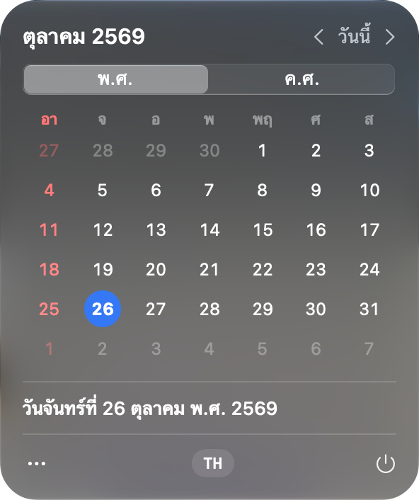
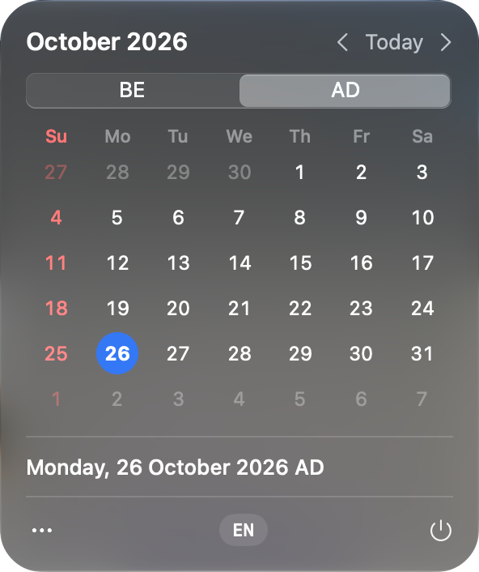

# Mojo Calendar Bar

ปฏิทินบนแถบเมนู macOS ภาษาไทย/อังกฤษ สลับ พ.ศ./ค.ศ. ได้ในคลิกเดียว

โดย [Mojozoft](https://mojozoft.com) · [ช่วยเหลือ](https://mojozoft.com/support/) · [Help (English)](https://mojozoft.com/en/support/) · [ความเป็นส่วนตัว](https://mojozoft.com/privacy/)

<p align="center">
  
  &nbsp;
  
</p>

## ดาวน์โหลด
1. โหลด `MojoCalendarBar-x.y.z.zip` จาก [Releases](https://github.com/mojozoft/mojo-calendar-bar/releases/latest) แล้วแตกไฟล์ ลาก `MojoCalendarBar.app` ไปไว้ใน **Applications**
2. เปิดครั้งแรก macOS จะบล็อก (แอปยังไม่ได้ notarize) ⇒ **System Settings → Privacy & Security → Open Anyway**
- ต้องใช้ Mac ชิป Apple Silicon · macOS 14 ขึ้นไป (หน้าต่างแบบ Liquid Glass บน macOS 26+)

## วิธีใช้
- **ไอคอนบนแถบเมนู** = เลขวันที่วันนี้ เปลี่ยนเองตอนข้ามวัน/ตื่นจากหลับ · คลิกเพื่อเปิดปฏิทิน
- **‹ ›** เลื่อนเดือน · **วันนี้** กลับมาเดือนปัจจุบัน
- **พ.ศ. / ค.ศ.** สลับระบบปี
- **กดชื่อเดือน** วนรูปแบบหัวปฏิทิน 4 แบบ (ตุลาคม 2569 · ตุลาคม พ.ศ. 2569 · ต.ค. 69 · 10/2569)
- **กดวันที่** ดูวันที่เต็ม + นับว่าอีกกี่วัน / ผ่านมาแล้วกี่วัน
- **TH / EN** (แถวล่าง) สลับภาษา
- **⋯** แสดงเลขสัปดาห์ · เปิดเองตอนเข้าเครื่อง · คัดลอกวันที่ (แบบเต็ม/แบบสั้น)
- **⋯ → ช่วยเหลือ / เว็บไซต์ Mojozoft** เปิด [mojozoft.com](https://mojozoft.com/support/)
- **⏻** ปิดแอป

## Build
```bash
./build-app.sh            # ได้ build/MojoCalendarBar.app
./build-app.sh --install  # ก๊อปไป /Applications แล้วเปิด
```

## โครงสร้าง
- `ThaiDate.swift` — คำนวณด้วย Gregorian เสมอ แล้วบวก 543 ตอนแสดงผล (ไม่ใช้ `Calendar(.buddhist)` กันตีความปีผิด)
- `CalendarView.swift` — หน้าต่างปฏิทิน · `App.swift` — ไอคอน, ตัวจับข้ามวัน, launch at login

## กับดักที่เจอ
- `Text("\(Int)")` ใส่ลูกน้ำคั่นหลักพัน (ค.ศ. 2,026) ⇒ ใช้ `Text(verbatim:)` หรือ String
- ปุ่มแรกในหน้าต่างมีกรอบโฟกัสฟ้าค้าง ⇒ `.focusable(false)`
- `MenuBarExtra(.window)` วาดพื้นแบบเก่า (ทึบ มุมเล็ก ขอบเทา) ไม่ใช่ Liquid Glass แบบเมนูระบบ ⇒ `Glass.swift` ซ่อน NSVisualEffectView เดิม + หน้าต่างโปร่ง + ตัดมุม layer + `.glassEffect` (macOS 26+)
- หน้าต่างเปลี่ยนขนาด (เช่นเปิดเลขสัปดาห์) ⇒ กรอบเดิมของระบบโผล่กลับ ⇒ ความกว้างคงที่ 296 + ซ่อนพื้นเดิมซ้ำตอน resize
  · ⚠️ ซ่อนซ้ำเฉพาะ effect view ที่จำไว้ตอนเปิดครั้งแรก — ไล่หาใหม่หลัง SwiftUI วาดแล้วจะไปซ่อน Divider + วงวันนี้ด้วย (เคยหายทั้งคู่)
- `Menu` แบบ `.borderlessButton` บน macOS 26 มีพื้นกลมโผล่ ⇒ `.menuStyle(.button)` + `.buttonStyle(.borderless)`

## ไอคอนแอป
- แบบที่เลือก = **T** (ช่องมน 3×3 · ช่องกลาง = วันนี้ · หัวปฏิทินขาวจาง · พื้นส้ม Mojozoft) — ทุกแบบที่ลองอยู่ใน `design/logo/index.html`
- สร้างใหม่: `python3 design/icon/make_icon.py` → `Resources/AppIcon.icns` (ตัวเลขต้องตรงกับ `FINAL()` ในหน้าเทียบ)
- เงาต้องวาดเป็นชั้นแยก + `filterUnits="userSpaceOnUse"` — `feDropShadow` ใน rsvg โดนตัดเป็นกรอบเหลี่ยม
- macOS 26+ ใส่เอฟเฟกต์กระจกให้ไอคอนเอง ไม่ต้องวาดเงา/ไฮไลต์เพิ่ม

## License
[PolyForm Noncommercial 1.0.0](LICENSE) — อ่าน แก้ build ใช้เองได้ (ไม่ใช่เชิงพาณิชย์) · **ห้ามขายหรือใช้เชิงพาณิชย์** · ต้องการใช้เชิงพาณิชย์ติดต่อ Mojozoft
Copyright (c) 2026 Mojozoft
